<picture>
  <source media="(prefers-color-scheme: dark)" srcset="assets/hero-dark.svg">
  
</picture>

<a href="https://www.gichogumacharia.tech/"><picture><source media="(prefers-color-scheme: dark)" srcset="assets/nav-brand-dark.svg"></picture></a><a href="#about"><picture><source media="(prefers-color-scheme: dark)" srcset="assets/nav-about-dark.svg"></picture></a><a href="#work"><picture><source media="(prefers-color-scheme: dark)" srcset="assets/nav-work-dark.svg"></picture></a><a href="#stack"><picture><source media="(prefers-color-scheme: dark)" srcset="assets/nav-stack-dark.svg"></picture></a><a href="#now"><picture><source media="(prefers-color-scheme: dark)" srcset="assets/nav-now-dark.svg"></picture></a><a href="#contact"><picture><source media="(prefers-color-scheme: dark)" srcset="assets/nav-contact-dark.svg"></picture></a>

 

<picture>
  <source media="(prefers-color-scheme: dark)" srcset="assets/h-about-dark.svg">
  
</picture>

<picture>
  <source media="(prefers-color-scheme: dark)" srcset="assets/about-dark.svg">
  
</picture>

 

<picture>
  <source media="(prefers-color-scheme: dark)" srcset="assets/h-work-dark.svg">
  
</picture>

<a href="https://github.com/Mr-Macharia/mpesa-daraja-skills-and-mcp"><picture><source media="(prefers-color-scheme: dark)" srcset="assets/card-mpesa-dark.svg"></picture></a>

<a href="https://github.com/Mr-Macharia/mpesa-daraja-skills-and-mcp"><picture><source media="(prefers-color-scheme: dark)" srcset="assets/link-code-dark.svg"></picture></a>&nbsp;<a href="https://pypi.org/project/mpesa-daraja-mcp/"><picture><source media="(prefers-color-scheme: dark)" srcset="assets/link-pypi-dark.svg"></picture></a>

<a href="https://github.com/Mr-Macharia/whatsapp-ai-assistant"><picture><source media="(prefers-color-scheme: dark)" srcset="assets/card-whatsapp-dark.svg"></picture></a>&nbsp;<a href="https://voice-agent.gichogumacharia.tech/"><picture><source media="(prefers-color-scheme: dark)" srcset="assets/card-voice-dark.svg"></picture></a>

<a href="https://github.com/Mr-Macharia/whatsapp-ai-assistant"><picture><source media="(prefers-color-scheme: dark)" srcset="assets/link-whatsapp-code-dark.svg"></picture></a>&nbsp;<a href="https://voice-agent.gichogumacharia.tech/"><picture><source media="(prefers-color-scheme: dark)" srcset="assets/link-voice-demo-dark.svg"></picture></a>&nbsp;<a href="https://github.com/Mr-Macharia/Website-Voice-Agent"><picture><source media="(prefers-color-scheme: dark)" srcset="assets/link-voice-code-dark.svg"></picture></a>

<a href="https://github.com/Mr-Macharia/medical-insurance-project"><picture><source media="(prefers-color-scheme: dark)" srcset="assets/card-medical-dark.svg"></picture></a>

<a href="https://github.com/Mr-Macharia/medical-insurance-project"><picture><source media="(prefers-color-scheme: dark)" srcset="assets/link-code-dark.svg"></picture></a>

  <b>MORE WORK</b> &nbsp;
  <a href="https://github.com/Mr-Macharia/AI-Logo-Design-Agent">AI Logo Design Agent</a> ·
  <a href="https://github.com/Mr-Macharia/Customer-Research-App">Customer Research</a> ·
  <a href="https://github.com/Mr-Macharia/--Truth-AI">Truth AI</a> ·
  <a href="https://github.com/Mr-Macharia/AI-Admin-Assistant">AI Admin Assistant</a> ·
  <a href="https://github.com/Mr-Macharia/application_generator">Application Generator</a> ·
  <a href="https://github.com/Mr-Macharia/Fake-Kenyan-Passport-Detection">Passport Forgery Detection</a> ·
  <a href="https://github.com/Mr-Macharia?tab=repositories">all repositories ↗</a>

 

<picture>
  <source media="(prefers-color-scheme: dark)" srcset="assets/h-stack-dark.svg">
  
</picture>

<picture>
  <source media="(prefers-color-scheme: dark)" srcset="assets/stack-dark.svg">
  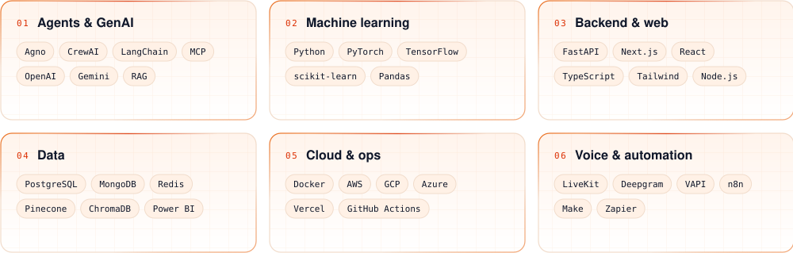
</picture>

  

<picture>
  <source media="(prefers-color-scheme: dark)" srcset="assets/h-now-dark.svg">
  
</picture>

<picture>
  <source media="(prefers-color-scheme: dark)" srcset="assets/now-dark.svg">
  
</picture>

<picture>
  <source media="(prefers-color-scheme: dark)" srcset="assets/telemetry-dark.svg">
  
</picture>

<picture>
  <source media="(prefers-color-scheme: dark)" srcset="https://raw.githubusercontent.com/Mr-Macharia/Mr-Macharia/output/snake-dark.svg">
  
</picture>

  

<picture>
  <source media="(prefers-color-scheme: dark)" srcset="assets/h-philosophy-dark.svg">
  
</picture>

<picture>
  <source media="(prefers-color-scheme: dark)" srcset="assets/quote-dark.svg">
  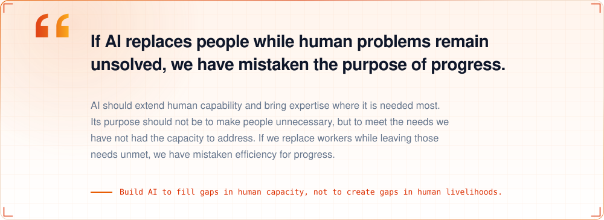
</picture>

  

<picture>
  <source media="(prefers-color-scheme: dark)" srcset="assets/h-contact-dark.svg">
  
</picture>

<picture>
  <source media="(prefers-color-scheme: dark)" srcset="assets/cta-dark.svg">
  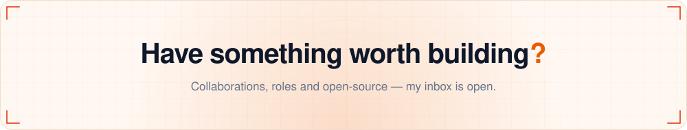
</picture>

<a href="mailto:ai@gichogumacharia.tech"><picture><source media="(prefers-color-scheme: dark)" srcset="assets/btn-email-dark.svg"></picture></a>&nbsp;<a href="https://www.gichogumacharia.tech/"><picture><source media="(prefers-color-scheme: dark)" srcset="assets/btn-portfolio-dark.svg"></picture></a>&nbsp;<a href="https://linkedin.com/in/gichogu-macharia"><picture><source media="(prefers-color-scheme: dark)" srcset="assets/btn-linkedin-dark.svg"></picture></a>&nbsp;<a href="https://wa.me/254101656882"><picture><source media="(prefers-color-scheme: dark)" srcset="assets/btn-whatsapp-dark.svg"></picture></a>

 

<picture>
  <source media="(prefers-color-scheme: dark)" srcset="assets/footer-dark.svg">
  
</picture>
